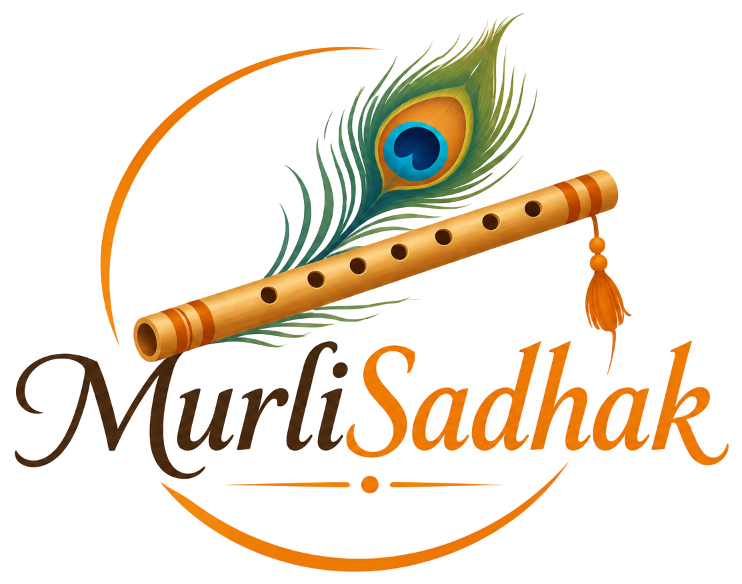

<p align="center">
  
</p>

<h1 align="center">🪈 MurliSadhak</h1>

<p align="center">
  <strong>Personal Indian Classical Bansuri (Flute) Riyaaz Studio & Practice Companion</strong>
</p>

<p align="center">
  <em>"A little every day. A lifetime of music."</em>
</p>

<p align="center">
  
  
  
  
  
  
</p>

---

## 📑 Table of Contents

- [The Story Behind MurliSadhak](#-the-story-behind-murlisadhak)
- [Why Indian Classical Flute Sadhaks Need This](#-why-indian-classical-flute-sadhaks-need-this)
- [Feature Highlights](#-feature-highlights)
  - [1. Studio Dashboard & Practice Rhythm](#1-studio-dashboard--practice-rhythm)
  - [2. Live Interactive Session Studio & Runtime Engine](#2-live-interactive-session-studio--runtime-engine)
  - [3. Sustained Breath Capacity Stopwatch](#3-sustained-breath-capacity-stopwatch)
  - [4. Procedural Acoustic Tanpura Drone (Web Audio API)](#4-procedural-acoustic-tanpura-drone-web-audio-api)
  - [5. Accompaniment Hub (Spardha Tabla & Tanpura)](#5-accompaniment-hub-spardha-tabla--tanpura)
  - [6. Learning Library: Techniques with Multiple Video Lessons](#6-learning-library-techniques-with-multiple-video-lessons)
  - [7. Classical Raag Repertoire Reference](#7-classical-raag-repertoire-reference)
  - [8. Bamboo & PVC Flute Care Diary](#8-bamboo--pvc-flute-care-diary)
  - [9. Video Hub & Repertoire Wishlist](#9-video-hub--repertoire-wishlist)
  - [10. Data Backup & Local Portability](#10-data-backup--local-portability)
- [A Sadhak's Philosophy: Why No "Mastered" Status?](#-a-sadhaks-philosophy-why-no-mastered-status)
- [Quick Start Guide](#-quick-start-guide)
- [Project Directory Structure](#-project-directory-structure)
- [Technology Stack](#-technology-stack)
- [Credits & Acknowledgements](#-credits--acknowledgements)
- [License](#-license)

---

## 📖 The Story Behind MurliSadhak

Playing the Indian Classical Bansuri (bamboo flute) is a meditative and lifelong journey. But every dedicated flute sadhak faces the daily chaos of fragmented digital practice:

- **Browser Tab Overload:** 10+ tabs open simultaneously—one for an online tabla beat, another for a tanpura drone, and scattered YouTube tabs for *alankar* and *meend* drills.
- **Interrupted Focus:** Fumbling with a phone stopwatch to time sustained *Sa* long notes breaks embouchure, posture, and breath control.
- **Instrument Damage:** Bamboo flutes cracking or losing tonal resonance because routine oiling and bore inspection dates were forgotten.
- **Superficial Gamification:** Mainstream music apps treat learning with checkboxes like *"You've mastered Meend!"*—completely contradicting Indian Classical philosophy, where swar sadhana is an endless, deepening path of awareness.

**MurliSadhak** was designed and built by a flautist to solve these exact friction points—creating a unified, peaceful, and functional digital sanctuary for daily Bansuri sadhana.

---

## ✨ Feature Highlights

### 1. Studio Dashboard & Practice Rhythm
- **Live Weekly Metrics:** Tracks practice hours against your weekly goal, current streak rhythm, total monthly sessions, and songs in active learning.
- **Today's Session Blueprint:** Real-time overview of planned activities with 1-click launch into the practice room.
- **Flute Health Overview:** Highlights instruments due for swabbing or oiling.
- **Custom Sadhak Profile:** Personalize your Sadhak Name, Initials badge, Primary Bansuri scale, and Practice Motto.

### 2. Live Interactive Session Studio & Runtime Engine
- **Minute-by-Minute Planner:** Divide practice time across *Long Notes*, *Alankars*, and *Ornaments* (*Meend*, *Gamak*, *Jhala*).
- **Runtime Segment Countdown:** Displays the **Current Technique** and **Upcoming Technique** in real-time.
- **On-the-Fly Runtime Additions:** Add `+5 min` or `+10 min` to your active technique or insert a new activity mid-session without stopping.
- **Riyaaz History Log:** Automatically archives completed sessions with duration, mood, notes, and flute used.

### 3. Sustained Breath Capacity Stopwatch
- Integrated stopwatch built directly into the live session studio.
- Measure sustained *Sa* lung capacity and diaphragmatic control with 1-click hold logging and historical personal best tracking.

### 4. Procedural Acoustic Tanpura Drone (Web Audio API)
- Pure zero-latency Indian Classical Tanpura synthesized mathematically in the browser using the **Web Audio API**.
- Covers all 12 western chromatic root notes: `C`, `C#`, `D`, `D#`, `E`, `F`, `F#`, `G`, `G#`, `A`, `A#`, `B`.
- Multiple first-string tuning modes:
  - **Pa-Sa (Pancham):** For standard bilateral raags (Yaman, Bhupali, Bilawal).
  - **Ma-Sa (Madhyam):** For raags omitting Pa (Malkauns, Bageshri).
  - **Ni-Sa (Nishad):** For raags with dominant Teevra Ma / Komal Re (Marwa, Puriya).
- Rich natural harmonics, subtle tremolo, and acoustic *jawari* thread buzz with real-time soundwave visualization.

### 5. Accompaniment Hub (Spardha Tabla & Tanpura)
- Built-in launchcards and live controls for:
  - **[Spardha Online Tabla Beats](https://www.spardhaschoolofmusic.com/tools/tabla):** Teentaal, Keherwa, Dadra, Rupak, and Jhaptal.
  - **[Spardha Online Shruti Box & Tanpura](https://www.spardhaschoolofmusic.com/tools/tanpura):** Authentic studio-recorded acoustic drone.

### 6. Learning Library: Techniques with Multiple Video Lessons
- Core Bansuri techniques: *Meend*, *Gamak*, *Murki*, *Komal Swars*, *Alankars*, *Kan Swar*, *Jhala & Tonguing*.
- **Multiple YouTube Tutorial Videos per Technique:** Attach 2, 3, or more lessons, masterclasses, and practice drills to each technique.
- **100% Crisp Thumbnails:** High-resolution video previews with centered play overlays (no faded images).
- **Controls Below the Thumbnail:**
  - `Watch on website`: Plays immediately in an in-app theater modal without redirecting away.
  - `YouTube ↗`: Opens in a new tab if you prefer full YouTube navigation.
  - `Delete`: Remove individual lessons anytime.
- Real-time thumbnail preview verification when pasting YouTube URLs.

### 7. Classical Raag Repertoire Reference
- In-depth raag profiles: *Raag Yaman, Raag Bhupali, Raag Bhairav, Raag Bageshri, Raag Darbari Kanada*, and more.
- Classical attributes: **Thaat**, **Prahar** (Time of day), **Aroha**, **Avroha**, **Vadi**, **Samvadi**, **Pakad**, and **Rasa**.
- Curated legendary bansuri performances (*Pt. Hariprasad Chaurasia, Pt. Ronu Majumdar, Pt. Pravin Godkhindi, Pt. Pannalal Ghosh*) playable in-app.

### 8. Bamboo & PVC Flute Care Diary
- Inventory manager for both Bamboo (*Assam/Kerala seasoned*) and PVC (*synthetic weather-proof*) flutes.
- Automated maintenance schedules: Tracks *Last Cleaned* and *Next Due* dates with "Ready" vs "Care due" badges.
- **1-Click Quick Clean:** Log routine swabbing or oiling in seconds.
- Detailed maintenance observation log for bore dryness, thread bindings, and acoustic tonal changes.

### 9. Video Hub & Repertoire Wishlist
- Curated repository of bansuri song tutorials and classical bandishes.
- Synced wishlist stages: *Want to learn*, *Learning*, and *Learned*.
- In-app streaming player with individual song deletion and note-taking.

### 10. Data Backup & Local Portability
- **100% Private & Local:** All your riyaaz logs, breath records, and flute data are stored securely in browser `localStorage`.
- **JSON Backup & Restore:** Export your complete studio database as a JSON file and restore it on any computer in one click.

---

## 🪈 A Sadhak's Philosophy: Why No "Mastered" Status?

In modern task managers, items are ticked off as *"Completed"* or *"Mastered"*. 

In Indian Classical Music, **swar sadhana is a lifelong path of refinement**. Legendary maestros spend 50+ years deepening their *Meend* or *Komal Re*. Declaring a technique "mastered" is an illusion that hinders growth.

Therefore, in MurliSadhak, technique stages are strictly limited to:
- **`Learning`** (Active daily sadhana)
- **`Not started`** (Yet to be explored)

There is intentionally **no "Mastered" option**, honoring our timeless musical heritage.

---

## 🚀 Quick Start Guide

### Option 1: One-Click Windows Launcher (Easiest)
In the project folder, double-click:
```text
start.bat
```
*This starts the server on port 8080 and automatically opens http://localhost:8080 in your default browser.*

---

### Option 2: Run directly from Command Prompt (CMD / Terminal)
Open CMD in the project folder and run:
```cmd
node server.js
```
*(Or if you prefer Python: `python -m http.server 8080`)*

Then open:
👉 **[http://localhost:8080](http://localhost:8080)**

---

### Option 3: Direct File Launch (No Server Needed)
Double-click **`index.html`** in Windows Explorer to run the entire studio directly in Chrome, Edge, or Brave.

---

## 📂 Project Directory Structure

```text
MurliSadhak/
├── index.html          # Main single-page application structure & modals
├── app.js              # Application router, state store & UI renderer
├── tanpura.js          # Procedural Web Audio API acoustic Tanpura generator
├── styles.css          # Custom styling, scrollbars & animations
├── server.js           # Lightweight zero-dependency Node HTTP server (port 8080)
├── start.bat           # One-click Windows desktop launcher
├── logo.png            # Official high-resolution transparent logo
├── logo-icon.png       # Circular Morpankh & Bansuri emblem icon
├── favicon.png         # 64x64 browser tab icon
├── package.json        # Project metadata and run scripts
├── LICENSE             # MIT License
└── README.md           # Comprehensive documentation & guide
```

---

## 🛠️ Technology Stack

| Layer | Technology |
|---|---|
| **Core Architecture** | Pure Modern Vanilla JavaScript (ES6+ Modules) |
| **Styling** | Tailwind CSS (via CDN) + Custom Handcrafted CSS |
| **Audio Synthesis** | Native Web Audio API (`tanpura.js`) |
| **Storage Engine** | Browser `localStorage` + JSON Import/Export Portability |
| **Server** | Native Node.js `http` module (Zero third-party dependencies) |
| **Design Language** | Saffron Terracotta Orange (`#ea580c`), Warm White (`#fcfbf9`), Deep Ebony (`#151413`) |

---

## 🪈 Credits & Acknowledgements

- **Accompaniment Tools:** [Spardha School of Music](https://www.spardhaschoolofmusic.com/) for their [Online Tabla Beats](https://www.spardhaschoolofmusic.com/tools/tabla) and [Online Shruti Box](https://www.spardhaschoolofmusic.com/tools/tanpura).
- **Celebration Effects:** [Canvas Confetti](https://www.npmjs.com/package/canvas-confetti) by Kiril Vatev.
- **Inspiration:** The timeless bansuri legacy of *Pt. Pannalal Ghosh*, *Pt. Hariprasad Chaurasia*, and all dedicated bansuri sadhaks worldwide.

---

## 📜 License

This project is licensed under the **MIT License** — see the [LICENSE](LICENSE) file for details.

*Built with devotion for Indian Classical Music.* 🪈
